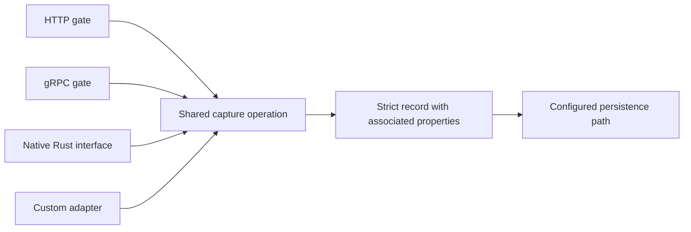

# Gates, one capture path, and a small event envelope

2026-10-23. Operator requirements and their immediate design implications.
Storage, concrete schema fields, codecs, frameworks and dependencies remain
undecided. This is design work, not an implementation plan.

[The capture-contract candidate](capture-contract.md) distinguishes fixed record
fields from associated arbitrary properties, and develops ownership and failure
rules. The actual record-field list is still to be chosen.

## The promise begins when a request reaches a gate

Ship HTTP and gRPC gates, native Rust integration, and a supported interface and
guide for writing other adapters. A request that reaches a gate belongs to the
capture population. Successful event decoding, validation or queue admission
cannot be prerequisites for counting it. Retries are additional arrivals.

The operator explicitly rejected preserving requests in their entirety. Persist
event contents only, without an additional request/body archive or second capture
layer. Adapters must identify where content enters their supported gate and keep
it owned through conversion. Caller-visible completion still needs defined
semantics, but cannot determine whether an earlier arrival counts.

## All integrations use one owned capture operation

This diagram describes the shared contract, not a writer/thread/process layout.
Integrations translate incoming representations and invoke the supported capture
interface. They do not acquire engine storage handles, invoke internal mutation
stages, choose weaker checks, or append through an alternate route.

The module/export surface and ownership model must enforce that boundary.
A private wrapper around a raw handle cannot establish exclusivity if other raw
copies escape. Public inspection/data types need not expose executable internal
stages. Shared event interpretation and retention outcomes belong to the common
operation; transport-specific conversions must preserve that contract. Extend
the supported interface when necessary instead of granting an integration a
private bypass.

The custom-adapter guide must explain gate observation, payload ownership,
normal/fallback conversion, completion, errors, cancellation and shutdown. An
adapter must account for paths that fail before ordinary event construction,
as well as the successful path. Native Rust callers use the same capture contract.

## Strict record schema, associated arbitrary properties

An event consists of schema-defined record fields with associated arbitrary
property key/value pairs. The individual property entries are outside the record
schema. They do not become new record fields as property keys change. The exact
record fields still need to be chosen; the former one-field proposal is withdrawn.

A field such as `property_hash` could be part of a record schema without making
the associated property pairs members of that schema. This is a possibility,
not a requirement that every record carry that field. The distinction does not
prescribe separate storage or an additional capture layer.

The interface must separate record fields and properties unambiguously. A property
key matching a record field cannot overwrite that field. Native values and binary
storage remain the working doctrine; no property value domain, container, encoding
or hash algorithm is selected here.

Conversion must preserve the event contents under the declared mapping. Content
that cannot fit ordinary properties may use opaque representation or references,
with a valid record populated according to defined schema rules. A diagnostic is
not a substitute for retaining the content, and conversion failure does not
remove an arrival from capture accounting. Those fallback rules need to be made
concrete alongside the record-field choice.

## Large content and references

Large blobs may be represented by paths or other references in properties. Avoid
requiring a large payload to be copied into one giant in-memory property value.
The eventual implementation must state what it owns at every handoff.

A reference and its target are distinct data. Persisting an event containing a
caller-supplied path preserves that path; it does not establish that the target
bytes were copied, remain accessible or are durable. A string property is data
unless an explicit artifact interface assigns it additional meaning.

If the adapter or engine takes responsibility for retaining blob bytes, its
artifact operation must join the same capture contract. The event must not claim
that owned content is retained before that content reaches the promised storage
boundary. Partial uploads, missing targets, interrupted publication and abandoned
artifacts need specified outcomes. These are design obligations, not a decision
to add an object store or fetch every path appearing in properties.

## Faults the design must address

Normal decoding failure must still have a representable capture result. Queue
exhaustion, cancellation after arrival, adapter shutdown and storage failure
remain part of the all-arrival objective. A fallback depending entirely on the
same exhausted resource is insufficient as a failure mechanism. Likewise,
retaining only an error counter cannot replace a missing payload.

The representational goal is to associate any arriving content with a valid
schema-defined record somehow. Actual retention reliability remains deployment-funded: concrete storage,
capacity and failure handling must support the desired nines and speed. An I/O
failure does not make the request cease to have reached the gate.

Later design checks should attack loss during conversion, different interpretations
across adapters, escaped internal handles, early-return paths, unknown outcomes
after cancellation, and event/artifact publication ordering. These are proposed
fault classes, not tests that have already run.
