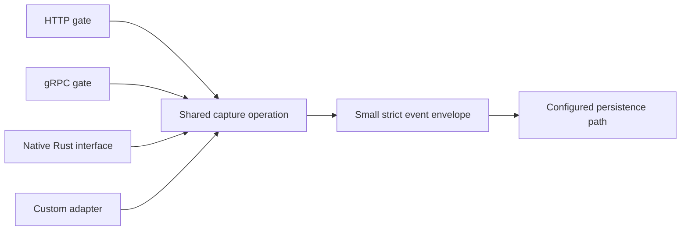

# Gates, one capture path, and a small event envelope

2026-10-23. Operator requirements and their immediate design implications.
Storage, concrete schema fields, codecs, frameworks and dependencies remain
undecided. This is design work, not an implementation plan.

[The capture-contract candidate](capture-contract.md) proposes a one-field event
and develops the content conversion, ownership and failure rules for review.

## The promise begins when a request reaches a gate

Ship HTTP and gRPC gates, native Rust integration, and a supported interface and
guide for writing other adapters. A request that reaches a gate belongs to the
capture population. Successful event decoding, validation or queue admission
cannot be prerequisites for counting it. Retries are additional arrivals.

The operator explicitly rejected preserving requests in their entirety. Persist
event contents only, without an additional request/body archive or second capture
layer. Adapters must identify where content enters their supported gate and keep
it owned through conversion. Caller-visible completion still needs defined
semantics, but cannot determine whether an earlier arrival counts.

## All integrations use one owned capture operation

This diagram describes the shared contract, not a writer/thread/process layout.
Integrations translate incoming representations and invoke the supported capture
interface. They do not acquire engine storage handles, invoke internal mutation
stages, choose weaker checks, or append through an alternate route.

The module/export surface and ownership model must enforce that boundary.
A private wrapper around a raw handle cannot establish exclusivity if other raw
copies escape. Public inspection/data types need not expose executable internal
stages. Shared event interpretation and retention outcomes belong to the common
operation; transport-specific conversions must preserve that contract. Extend
the supported interface when necessary instead of granting an integration a
private bypass.

The custom-adapter guide must explain gate observation, payload ownership,
normal/fallback conversion, completion, errors, cancellation and shutdown. An
adapter must account for paths that fail before ordinary event construction,
as well as the successful path. Native Rust callers use the same capture contract.

## Strict envelope, arbitrary properties

The event has an extremely small, strictly schematized outer type. Its properties
carry arbitrary event content. Domain-specific fields and interpretations do not
continually expand the envelope. The exact required fields and property-value
representation have not been selected.

Every observable incoming payload needs a valid representation in that envelope.
Normal structured input can become properties; input that cannot be decoded or
represented normally must have an opaque-data or reference representation.
Conversion failure must not cause the original content to disappear. A diagnostic
alone is not a substitute for retaining the content under the chosen contract.
Unknown fields, unfamiliar event kinds and malformed content need explicit
handling without silently discarding the arrival.

Arbitrary properties do not require JSON as the internal model. Native values
and binary storage remain the working doctrine. Cross-language conversion must
not silently change numbers, binary values, malformed text or other distinctions
that the input representation preserves; opaque retention can cover content
outside the structured property domain. Property names and engine-generated
metadata also need a collision rule.

Strictness therefore makes the retained representation predictable while keeping
the payload domain broad. A valid outer event can describe an input that failed
normal decoding. This does not select multiple public envelope types, mandatory
diagnostic fields, a particular property namespace or a wire format.

## Large content and references

Large blobs may be represented by paths or other references in properties. Avoid
requiring a large payload to be copied into one giant in-memory property value.
The eventual implementation must state what it owns at every handoff.

A reference and its target are distinct data. Persisting an event containing a
caller-supplied path preserves that path; it does not establish that the target
bytes were copied, remain accessible or are durable. A string property is data
unless an explicit artifact interface assigns it additional meaning.

If the adapter or engine takes responsibility for retaining blob bytes, its
artifact operation must join the same capture contract. The event must not claim
that owned content is retained before that content reaches the promised storage
boundary. Partial uploads, missing targets, interrupted publication and abandoned
artifacts need specified outcomes. These are design obligations, not a decision
to add an object store or fetch every path appearing in properties.

## Faults the design must address

Normal decoding failure must still have a representable capture result. Queue
exhaustion, cancellation after arrival, adapter shutdown and storage failure
remain part of the all-arrival objective. A fallback depending entirely on the
same exhausted resource is insufficient as a failure mechanism. Likewise,
retaining only an error counter cannot replace a missing payload.

The representational goal is to fit any arriving content into the small envelope
somehow. Actual retention reliability remains deployment-funded: concrete storage,
capacity and failure handling must support the desired nines and speed. An I/O
failure does not make the request cease to have reached the gate.

Later design checks should attack loss during conversion, different interpretations
across adapters, escaped internal handles, early-return paths, unknown outcomes
after cancellation, and event/artifact publication ordering. These are proposed
fault classes, not tests that have already run.
